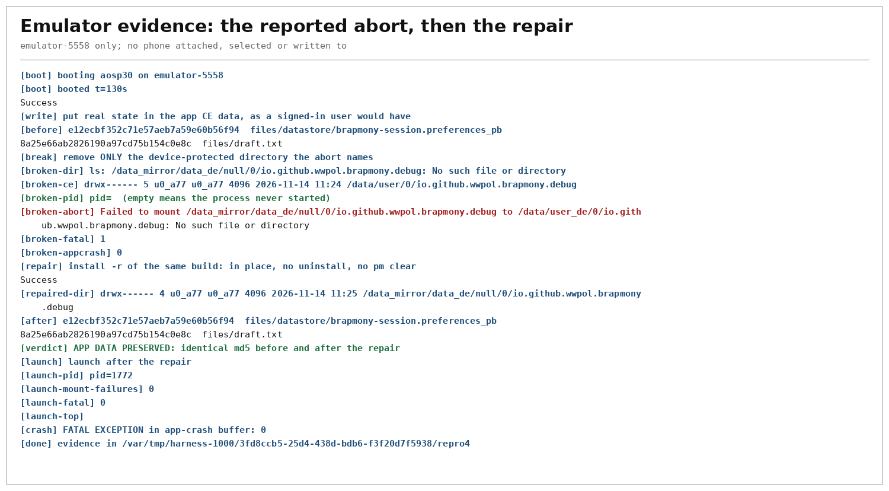

# The launch that aborted before the app: evidence

Every command in this directory ran against an emulator named explicitly
(`emulator-5558`). No physical device was attached, selected or written to. The
reported failure is on a Galaxy S23 Ultra; nothing here touched a phone.

The mechanism is in
[the data-directory notes](../../native-android-launch-data-directory.md).

## `repro4-steps.log` -- cause, and the repair that keeps data

The full run that turns the reading of the platform source into a demonstrated cause:

1. install the debug APK and write a session file and a draft into the app's data;
2. remove **only** `/data_mirror/data_de/null/0/io.github.wwpol.brapmony.debug`;
3. launch: the process never starts, and `logcat` holds the reported
   `JNI FatalError ... Failed to mount ... No such file or directory`
   (`logcat-broken.txt`), with `FATAL EXCEPTION` count 0 -- no app crash;
4. `adb install -r` the same build: the directory is back;
5. re-read the session file and draft: **identical md5**, so the data survived;
6. launch: `pid` present, 0 mount failures, 0 `JNI FatalError` (`logcat-repaired.txt`).

## `repro2-steps.log` -- the repairs that do not work

Same reproduction, three candidate repairs. `pm install-existing --user 0` and
`pm disable-user` then `pm enable` both leave the directory missing and the launch
aborting; only `install -r` repairs it. This is why the recommendation is a reinstall
rather than re-enabling the app.

## `steps.log` -- the shipped `doctor.sh`, end to end

| file | what it shows |
| --- | --- |
| `doctor-readonly.txt` | the read-only run finds the fault (exit 1) |
| `doctor-physical.txt` | a physical serial is refused without `--allow-physical` (exit 2) |
| `doctor-noserial.txt` | a missing `--serial` is refused: no device is guessed (exit 2) |
| `doctor-repair.txt` | `--repair` reinstalls in place and the directory is back (exit 0) |
| `doctor-after.txt` | a second read-only run reports the device healthy (exit 0) |

The read-only run was checked to change nothing: the directory listing was
byte-identical before and after it. After the repair, the app data was still identical,
and the app launched and was reported `Displayed` by the activity manager.

## What these logs are not

They are not screenshots. The emulator on this host has no `/dev/kvm`, and its
framebuffer reads back black (see
[the verification notes](../../native-android-verification.md)); a black PNG is not
evidence of a screen, so none is kept. What is kept is the process evidence: a `pid`
that exists or does not, the platform's own fatal line, and the activity manager's
`Displayed`.
